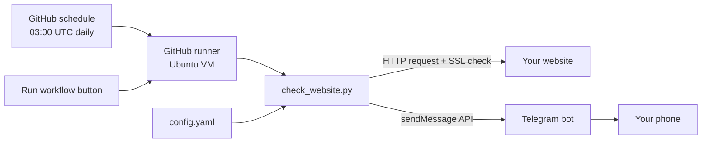

# 🛰️ Site Sentinel

[](https://github.com/ALPHAMAN-0/site-sentinel/actions/workflows/daily-check.yml)

A daily website watchdog, built to learn **GitHub Actions**.

Every day at **9:00 AM Bangladesh time**, GitHub runs a Python script that:

- checks whether your website's **server is up or down**
- collects the information you choose: **status code, response time, page title, meta description, SSL certificate expiry, and any text from the page** (CSS selectors)
- sends a report to you through a **Telegram bot**

You pick which checks run by editing `config.yaml`. You don't need to change any code.

## How it works



Example report:

```
🌐 Daily Website Report
🕘 16 Sep 2026, 09:00 AM (Bangladesh time)
📊 1 of 1 site(s) up

✅ My Website — UP
https://example.com
• Status code: 200
• Response time: 180 ms
• Title: Example Domain
• Description: (no description)
• Main heading: Example Domain
• SSL expires in: 84 days
```

## Files

| File | What it does |
|---|---|
| `.github/workflows/daily-check.yml` | The GitHub Actions workflow: **when** to run and **what steps** to run |
| `check_website.py` | Checks the websites and sends the Telegram message |
| `config.yaml` | Your website URL(s) and which checks are on or off |
| `requirements.txt` | Python packages: requests, beautifulsoup4, PyYAML |
| `Instruction.md` | **Full step-by-step guide for beginners** |

## Steps (short version)

For full details, screenshots-in-words, and troubleshooting, read **[Instruction.md](Instruction.md)**.

1. **Create a Telegram bot:** message [@BotFather](https://t.me/BotFather), send `/newbot`, and copy the **bot token**.
2. **Get your chat ID:** send your bot a message, open `https://api.telegram.org/bot<TOKEN>/getUpdates`, and copy `chat.id`.
3. **Edit `config.yaml`:** put in your website URL and set each check to `true` or `false`.
4. **Test on your Mac:**
   ```bash
   python3 -m venv .venv && source .venv/bin/activate
   pip install -r requirements.txt
   python check_website.py --dry-run
   ```
5. **Push to GitHub:** `git init`, `git add .`, `git commit -m "first commit"`, then create a repo and push.
6. **Add secrets:** go to repo **Settings → Secrets and variables → Actions** and add `TELEGRAM_BOT_TOKEN` and `TELEGRAM_CHAT_ID`.
7. **Run it once by hand:** go to the **Actions** tab, open **Daily Website Check**, click **Run workflow**, and check Telegram.
8. **Done.** It now runs every day at 9:00 AM Bangladesh time.

## Run behavior

- If any site is **DOWN**, the workflow run is marked **failed** ❌, so GitHub also emails you.
- Set `notify: only_on_problem` in `config.yaml` to get messages only when something is wrong.
- To check more websites, copy the site block in `config.yaml`.
